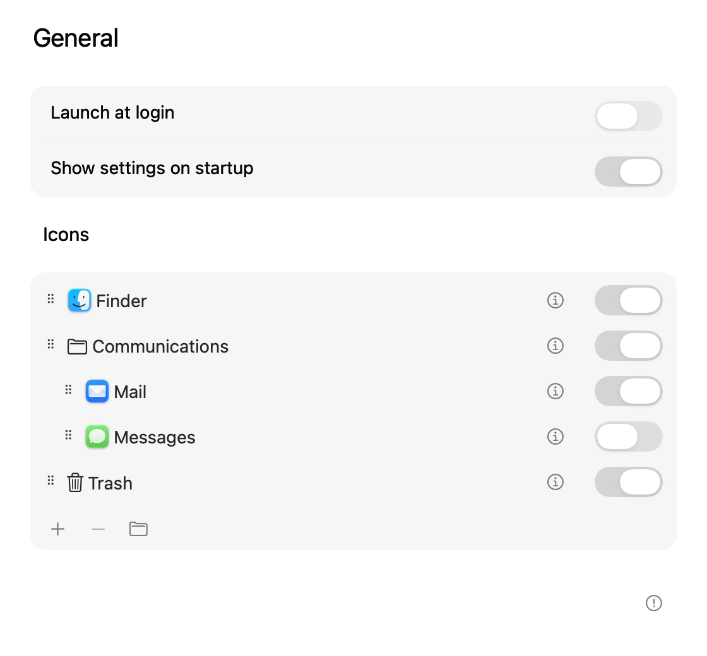

  

<h1 align="center">Pipmark</h1>

<strong>Your app badges, at a glance.</strong>

  <a href="https://pipmark.io/download"><strong>Download for Mac</strong></a> ·
  <a href="https://pipmark.io">Website</a> ·
  <a href="mailto:contact@pipmark.io">Get in touch</a>

Free · macOS 13+ · Apple silicon

Keep an eye on what’s waiting without opening every app. Pipmark brings your
Mac’s app notification badges into the menu bar, with a clean, native interface
that feels right at home.

  
   
  Your apps. A tidy list. Just the controls you need.

## A little utility that fits your day

- **See what needs your attention.** Keep your chosen apps’ badge counts in view while you work.
- **Keep your menu bar tidy.** Bring related apps together in groups.
- **Make it yours.** Choose icons, badge styles, and when each item appears.
- **Feel at home on your Mac.** Familiar controls, real app icons, and light and dark appearances.
- **Stay up to date.** Check for updates right inside Pipmark.

## Get started

1. [Download the DMG](https://pipmark.io/download) and drag Pipmark to Applications.
2. Open Pipmark and allow Accessibility access so it can read Dock badges.
3. Add your apps, choose how they appear, and get back to what you were doing.

Pipmark is signed and notarized by Apple. See [current capabilities and known limitations](docs/PARITY.md) for compatibility and validation details.

## Say hello

Questions, ideas, or feedback? Email **[contact@pipmark.io](mailto:contact@pipmark.io)**
or [open an issue](https://github.com/JaTochNietDan/pipmark/issues).

---

[Development](docs/DEVELOPMENT.md) · [Releases and updates](docs/UPDATES.md)

Pipmark is an independent project, unaffiliated with Badgeify.
